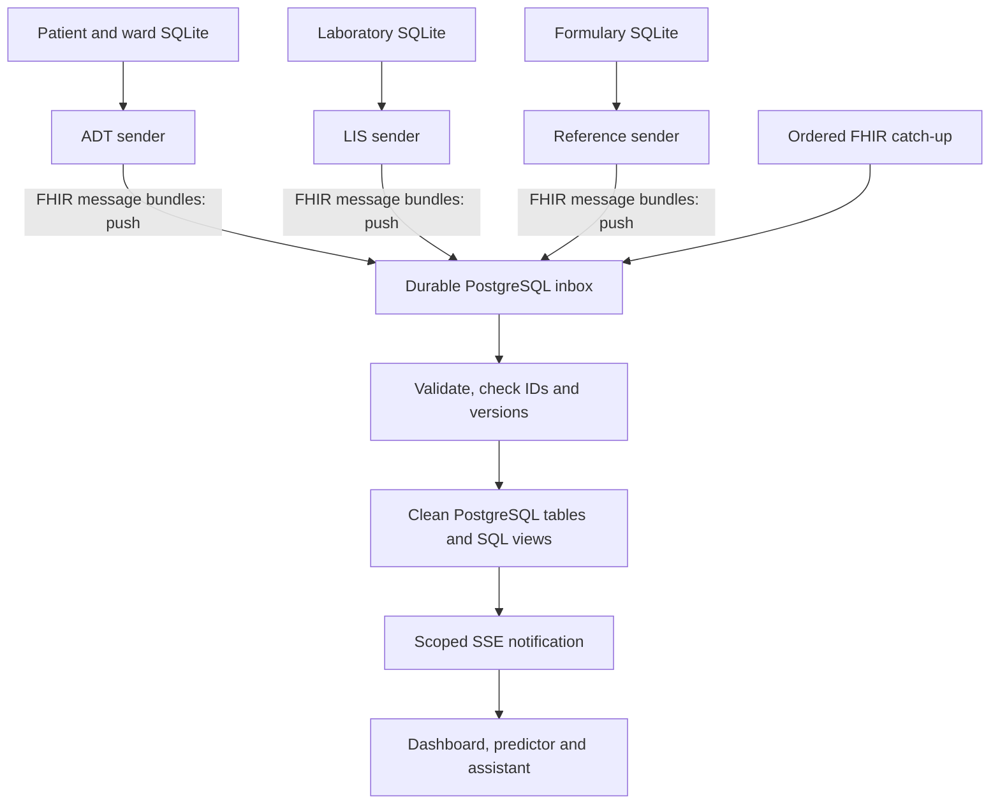

# Hospital integration in this project

The dashboard starts with the current data, then receives changes through a FHIR R4 intake. The hospital databases retain their ordinary relational schemas. FHIR is the exchange format, not a database schema.

## Sources and mappings

| Private source tables | Resources crossing the interface | Clean hub tables |
|---|---|---|
| ADT `patients` | Patient | `adt.patients` |
| ADT `wards` | Location | `adt.wards` |
| ADT `ward_stays` | Encounter with patient, location and admission date | `adt.ward_stays` |
| LIS `cultures` | DiagnosticReport and Specimen, with patient identifier | `lis.cultures` |
| LIS `isolates` | Organism Observation | `lis.isolates` |
| LIS `ast_results` | Susceptibility Observation, linked to its organism | `lis.ast_results` |
| LIS `specimen_types` | SpecimenDefinition | `lis.specimen_types` |
| Reference `antibiotics` | MedicationKnowledge | `formulary.antibiotics` |
| Reference `guidelines` | PlanDefinition reference entry | `formulary.guidelines` |

A live laboratory message groups the triggering change with the available specimen, report, organism and susceptibility context. Every triggering row comes from its committed outbox event. Patient, culture, ward and isolate business identifiers are retained. Logical FHIR IDs are deterministic hashes so composite keys and non-FHIR identifiers remain valid. References also carry the shared business identifier used for consolidation. A minimal Patient in a lab message provides context; it cannot overwrite ADT demographics.

Our data contains **drug catalogue information, not prescriptions, dispenses or administrations**. No medication orders are invented. An actual prescribing source would need its own private order tables and a MedicationRequest/MedicationDispense mapping before those could become clinical inputs. The predictor continues to distinguish recorded results from estimates and unknown medication history.

Existing ward stays were derived from sample patient/ward/admission-date combinations. Their Encounter mapping retains this provenance and uses `status=unknown`; it does not invent discharge times, current occupancy or transfer histories. A real admission/transfer feed needs an agreed encounter identifier and location periods. A transfer can update the existing Encounter's location history; creating a new admission for every movement would lose that continuity.

## Starting data and changes

On the first load into an empty hub, each hospital adapter takes a consistent private snapshot with an outbox watermark and converts it to bounded FHIR bundles. Those pass through the same inbox and normalization code as later events. The hub never downloads entire native tables over a snapshot API. Existing installations keep their already consolidated baseline and saved cursors.

SQLite triggers capture committed inserts, updates and deletes. Each source sender keeps a durable FHIR outbox and delivery cursor. API writes wake it immediately, while a 250 ms local check notices direct SQL changes. Messages are saved once and retried with the same identifier and content. A receipt is acknowledged only after the hub commits its clean-table changes.

The hub also catches up every two seconds through `GET /fhir/changes?after=<cursor>`. The cursor is a durable source event sequence. `meta.lastUpdated` remains in every data resource, but a sequence also handles equal timestamps and deletion tombstones. Push deliberately does not advance this catch-up watermark: an out-of-order push must not cause an earlier missed event to be skipped. Catch-up safely sees already pushed messages again.

New demo patients arrive every **30 seconds**. Lab identification and S/R stages overlap the following arrivals. This schedule is independent of message delivery: once a row changes, its sender can deliver it immediately. Reference catalogues are prepared once before the first patient. The inbox ZIP is only the local demo's input to the simulated hospital systems; ZIPs and CSV tables are never the hospital-to-hub integration protocol.

## Intake, versions and recovery

`POST /api/intake/fhir/{adt|lis|formulary}` accepts JSON or `application/fhir+json`. If `SOURCE_API_TOKEN` is configured, it requires the same `x-api-key`. All services remain bound to loopback.

1. Save the original identifiable JSON message in `integration_inbox` before validating clinical resources.
2. Validate the source, supported resources, identifiers, dates, coded values and application-required facts.
3. Under a source-specific database lock, apply only resource versions newer than `fhir_resource_state`. Upsert by clinical keys; apply explicit delete messages as tombstones.
4. Commit the clean rows, resource versions and processed inbox status together.
5. Notify open screens over SSE with the affected source, tables, patients, cultures, wards and organisms.

Messages are unique by source and message identifier. Retrying the same JSON is safe even if object property order changes. Reusing an identifier for different content is a conflict. Older resource versions cannot overwrite current values or resurrect deleted rows. A replayed generated patient can reuse its business ID because its next source event sequence is newer than its deletion.

This adapter assigns increasing numeric resource versions from its durable outbox. FHIR version identifiers in general are opaque; a new hospital converter must establish its own ordering contract rather than assuming all FHIR version strings are integers. Original source `record_version` values are retained separately for the existing editing forms.

Registered reports retain unknown results. Preliminary reports can be supplemented by AST results. Finalized reports and subsequent corrections update the same clinical keys. The exact `amended`/`corrected` FHIR status is retained in the inbox and resource state; the existing clean culture workflow represents these as final for reporting eligibility. The supplied S/R vocabulary remains S/R; broader interpretations require an explicit mapping.

Failed clinical messages are marked rejected with an error and do not partially modify clean tables. Inspect counts at `GET /api/intake/status`; inspect the saved payload/error in `integration_inbox`. After fixing a converter, `POST /api/intake/fhir/{source}/{message-id}/replay` reprocesses that saved message. An already applied replay is a no-op. A rejected event stops that source's ordered catch-up until repaired; other sources continue. Raw messages and tombstones are intentionally retained for audit/recovery.

Clean SQL views remain current when rows change. The server does not reload the dataset or rebuild every analysis. Scoped SSE invalidates relevant frontend queries, including the old and new clinical scopes of corrections. Filtered antibiograms and patient histories are recalculated on demand; this is not a separate materialized aggregate engine. The dashboard reads ready-made responses from the hub and never parses FHIR.

## The mentor's document example

The supplied example illustrates a **document** Bundle beginning with Composition, with linked DiagnosticReport and Observation resources. Our live integration uses **message** Bundles beginning with MessageHeader. This follows [FHIR R4 messaging](https://hl7.org/fhir/R4/messageheader.html); the same clinical report can be exchanged using several interaction styles, as described in [DiagnosticReport](https://hl7.org/fhir/R4/diagnosticreport.html).

The implementation uses a small project mapping with named local codes, business identifier systems and documented extensions for facts such as sample ward, age-at-sample and interpretation guideline. It does not claim conformance to the EU Laboratory document profiles in the example, fabricate SNOMED/LOINC equivalences, or implement an unrestricted FHIR server. Mentor agreement and formal profile/terminology validation are needed before connecting a real hospital. Confirm encounter and ward semantics against the actual source feed; [Encounter.location.period](https://hl7.org/fhir/R4/encounter.html) is the relevant FHIR construct.

## HL7 v2 and pitch wording

FHIR transport and conversion are separated from clean clinical tables, analytics and screens. A future HL7 v2 adapter can translate supported ADT/ORU messages into this same canonical intake; patient linking and downstream features then stay the same. The HL7 v2 parser/listener is **not implemented** in this revision.

Suggested pitch: “We consolidate hospital changes through a common intake. Our working integration uses FHIR today. The same design can accept older HL7 v2 feeds by adding a converter, while keeping the clinical tables, analysis and dashboard unchanged.”

## Relevant implementation

- `apps/api/src/fhir-mapping.ts`: resource mapping, baseline bundles, validation and normalization.
- `apps/api/src/fhir-source.ts`: three source-sender instances and durable FHIR catch-up.
- `apps/api/src/fhir-intake.ts`: inbox, idempotency, version checks, replay and scoped notifications.
- `apps/api/src/hub-store.ts`: clean queries and ordered catch-up.
- `apps/web/src/live-updates.ts`: affected-screen invalidation.
- `apps/api/src/demo-replay.ts`: protected restart reset for completed generated batches, separate from hospital integration.
